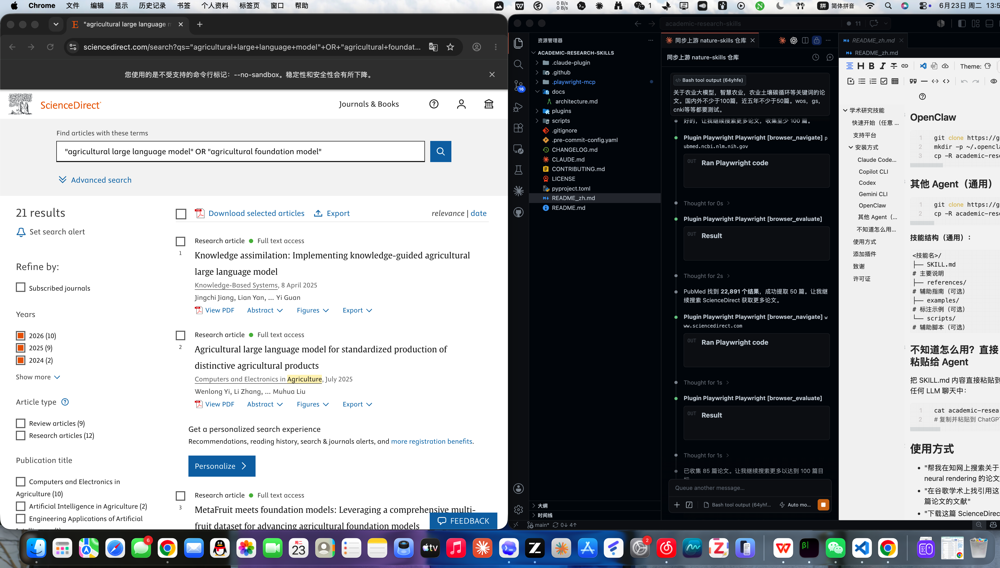

# 学术研究技能

[English](./README.md)

Claude Code / Codex 插件市场——从文献检索到成稿的完整学术研究工作流。

<p align="center">
  
</p>

## 工作流

```
① 平台站内检索            ② 文献获取                    ③ 写作辅助
cnki-search、pm-search →  scansci-pdf（下载、引文、   →  nature-*（综述、开题、润色、
拿到条目（DOI、标题）       Zotero 推送）                  审稿、专利）
```

47 个插件：46 个平台站内检索导航技能（知网、谷歌学术、ScienceDirect、Web of Science、PubMed、IEEE Xplore、Nature）+ `scansci-pdf` 文献获取中枢。论文下载、引文导出、Zotero 推送统一走 `scansci-pdf`；旧的 `*-download`、`*-export`、`zotero-csl` 技能已移除（迁移表见 `docs/REFERENCE.md`）。

## ✅ 端到端实测 — 2026-10-29

我们在干净环境用真实课题——**「半导体材料在电池中的创新应用」**——把完整工作流跑了一遍：从文献检索到文献综述、开题报告、文章骨架：

| 环节 | 技能 | 实测结果 |
|---|---|---|
| 检索 | `pm-search`（PubMed API 独立脚本） | ✅ 真实命中且 PMID/DOI 可验：硅负极方向 155 条、光充电电池方向 6 条 |
| 跨源发现 | `scansci-pdf search` | ✅ 13 源引擎真实返回；相关性偏宽——精确检索请用平台技能 |
| 下载 | `scansci-pdf get --strategy legal_only` | ✅ 经 Unpaywall 渠道获取一篇付费刊论文：71 页 PDF、自动按`作者_年份_标题`重命名、如实报告实际来源。首次失败（`config_needed`：缺邮箱）按技能指引配置后重试即成功 |
| 全文 | `scansci-pdf get --md` | ✅ 971 行含 OCR 的 Markdown，章节结构完整 |
| 精读与写作 | `nature-reader`、`nature-writing` | ✅ 产出证据锚点式精读笔记、13 条真实文献的综述、完整开题报告、英文文章骨架——零虚构引用（无数据处显式标注占位符） |

完整报告与原始证据：[`docs/test-evidence/2026-10-29-e2e-workflow/`](docs/test-evidence/2026-10-29-e2e-workflow/)。

**已知边界（如实写明，不藏）**：未装可选浏览器后端（`pip install "scansci-pdf[camoufox]"`）时，下载仅覆盖"OA 仓库直链"型文章——出版商官网 OA 与机构登录需要它。浏览器平台技能（CNKI/GS/SD/WoS/IEEE）需要宿主内有 Chrome DevTools MCP。2026-06-23 的各平台状态快照（GS/IEEE 当时超时）与全部失败签名见 `docs/PLAYBOOK.md`。

## 快速开始（任意 Agent）

直接发送给你的 agent：

```
从这个仓库安装所有学术研究技能：
https://github.com/YuanyuanMa03/academic-research-skills
```

适用于 Claude Code、Copilot CLI、Codex、Gemini CLI、ChatGPT、通义千问、DeepSeek，或任何能读取 GitHub 仓库的 LLM agent。


## 支持平台

| 平台 | 前缀 | 技能 | 数量 |
|------|------|------|------|
| 知网 (CNKI) | `cnki-*` | 搜索、期刊浏览、论文详情、结果解析、翻页 | 8 |
| 谷歌学术 (Google Scholar) | `gs-*` | 搜索、高级搜索、引用追踪、翻页 | 4 |
| ScienceDirect | `sd-*` | 搜索、期刊浏览、论文详情、结果解析、翻页 | 6 |
| Web of Science | `wos-*` | 搜索、DOM 参考、论文详情、结果解析、翻页 | 5 |
| PubMed | `pm-*` | 搜索（API 优先）、全文、论文详情、翻页 | 5 |
| IEEE Xplore | `ieee-*` | 搜索、期刊浏览、标准、论文详情、结果解析 | 7 |
| Nature | `nature-*` | 学术搜索、写作、润色、图表、阅读、专利、审稿 | 11 |
| ScanSci PDF | `scansci-pdf` | 论文下载、引文导出、Zotero 推送、批量队列、环境诊断 | 1 |

**共 47 个插件** — 7 个学术平台的站内检索导航 + [`scansci-pdf`](https://github.com/Rimagination/scansci-pdf)（MIT）文献获取中枢（下载 / 引文 / Zotero）。

> 浏览器技能（CNKI、GS、SD、WoS、IEEE）需要 [Chrome DevTools MCP](https://github.com/nicekid1/chrome-devtools-mcp)（各插件 `.mcp.json` 已内置）。PubMed 搜索走 NCBI API 独立脚本。`scansci-pdf` 需要 Python >= 3.11 并 `pip install scansci-pdf`（首次使用有引导）。Nature 系列是纯提示技能，任何 LLM 可用。
>
> 论文下载 / 引文导出 / Zotero 推送统一走 `scansci-pdf` —— 旧的 `*-download`、`*-export`、`zotero-csl` 技能已移除（决策记录见 `docs/PLAYBOOK.md`）。


## 安装方式

### Claude Code（推荐）

```bash
# 添加市场
/plugin marketplace add YuanyuanMa03/academic-research-skills

# 安装全部技能
/plugin install cnki-advanced-search@academic-research-skills
/plugin install cnki-journal-index@academic-research-skills
/plugin install cnki-journal-search@academic-research-skills
/plugin install cnki-journal-toc@academic-research-skills
/plugin install cnki-navigate-pages@academic-research-skills
/plugin install cnki-paper-detail@academic-research-skills
/plugin install cnki-parse-results@academic-research-skills
/plugin install cnki-search@academic-research-skills
/plugin install gs-advanced-search@academic-research-skills
/plugin install gs-cited-by@academic-research-skills
/plugin install gs-navigate-pages@academic-research-skills
/plugin install gs-search@academic-research-skills
/plugin install ieee-advanced-search@academic-research-skills
/plugin install ieee-journal-browse@academic-research-skills
/plugin install ieee-navigate-pages@academic-research-skills
/plugin install ieee-paper-detail@academic-research-skills
/plugin install ieee-parse-results@academic-research-skills
/plugin install ieee-search@academic-research-skills
/plugin install ieee-standards-search@academic-research-skills
/plugin install nature-academic-search@academic-research-skills
/plugin install nature-citation@academic-research-skills
/plugin install nature-data@academic-research-skills
/plugin install nature-figure@academic-research-skills
/plugin install nature-paper-to-patent@academic-research-skills
/plugin install nature-paper2ppt@academic-research-skills
/plugin install nature-polishing@academic-research-skills
/plugin install nature-reader@academic-research-skills
/plugin install nature-response@academic-research-skills
/plugin install nature-reviewer@academic-research-skills
/plugin install nature-writing@academic-research-skills
/plugin install pm-advanced-search@academic-research-skills
/plugin install pm-fulltext@academic-research-skills
/plugin install pm-navigate-pages@academic-research-skills
/plugin install pm-paper-detail@academic-research-skills
/plugin install pm-search@academic-research-skills
/plugin install scansci-pdf@academic-research-skills
/plugin install sd-advanced-search@academic-research-skills
/plugin install sd-journal-browse@academic-research-skills
/plugin install sd-navigate-pages@academic-research-skills
/plugin install sd-paper-detail@academic-research-skills
/plugin install sd-parse-results@academic-research-skills
/plugin install sd-search@academic-research-skills
/plugin install wos-dom@academic-research-skills
/plugin install wos-navigate-pages@academic-research-skills
/plugin install wos-paper-detail@academic-research-skills
/plugin install wos-parse-results@academic-research-skills
/plugin install wos-search@academic-research-skills
```

### Copilot CLI

```bash
git clone https://github.com/YuanyuanMa03/academic-research-skills.git
mkdir -p ~/.copilot/skills
cp -R academic-research-skills/plugins/*/skills/* ~/.copilot/skills/
```

| 技能工具 | Copilot CLI 等价工具 |
|----------|---------------------|
| `Read` | `view` |
| `Write` | `create` |
| `Edit` | `edit` |
| `Bash` | `bash` |
| `Grep` | `grep` |
| `WebFetch` | `web_fetch` |

### Codex（推荐使用 Marketplace）

Codex 通过 plugin 分发可复用 skills。本仓库已提供 Codex marketplace
`.agents/plugins/marketplace.json`，并为每个 skill 提供
`plugins/<name>/.codex-plugin/plugin.json`。

先把本仓库加入 Codex marketplace，然后在插件目录里安装需要的技能：

```bash
codex plugin marketplace add YuanyuanMa03/academic-research-skills
codex
/plugins
```

在插件目录中选择 **Academic Research Skills**，打开需要的插件并选择
**Install plugin**。安装完成后新开一个 Codex 线程使用。你可以用 `@`
显式调用某个插件或 skill，也可以直接描述任务，让 Codex 根据描述自动选择。

Codex plugin 安装包已经包含所需 MCP 配置：

- 浏览器类研究技能会通过 `npx` 启动 `chrome-devtools-mcp`。
- `nature-academic-search` 会启动内置 `academic-search` MCP server，并把
  Python 依赖自动安装到 `~/.cache/academic-search-mcp`。

也可以直接用 CLI 安装某个插件：

```bash
codex plugin add nature-academic-search@academic-research-skills
codex plugin add cnki-search@academic-research-skills
codex plugin add gs-search@academic-research-skills
```

常用 marketplace 管理命令：

```bash
codex plugin marketplace list
codex plugin marketplace upgrade academic-research-skills
codex plugin marketplace remove academic-research-skills
```

#### 手动安装 fallback

本仓库是 multi-skill collection，不要把仓库根目录当作单个 Codex skill
安装；应安装 `plugins/*/skills/*` 下的实际 skill 目录。

```bash
git clone https://github.com/YuanyuanMa03/academic-research-skills.git
mkdir -p ~/.codex/skills
cp -R academic-research-skills/plugins/*/skills/* ~/.codex/skills/
```

如果使用 Codex 的 GitHub skill installer，也要传入嵌套 skill 路径，而不是仓库根目录：

```bash
python3 /path/to/install-skill-from-github.py \
  --repo YuanyuanMa03/academic-research-skills \
  --path plugins/nature-academic-search/skills/nature-academic-search
```

| 技能工具 | Codex 等价工具 |
|----------|---------------|
| `Read`, `Write`, `Edit` | 原生文件工具 |
| `Bash` | 原生 Shell 工具 |
| `Skill` 工具 | 技能原生加载 |

### Gemini CLI

```bash
git clone https://github.com/YuanyuanMa03/academic-research-skills.git
mkdir -p ~/.gemini/skills
cp -R academic-research-skills/plugins/*/skills/* ~/.gemini/skills/
```

| 技能工具 | Gemini CLI 等价工具 |
|----------|---------------------|
| `Read` | `read_file` |
| `Write` | `write_file` |
| `Edit` | `replace` |
| `Bash` | `run_shell_command` |
| `Grep` | `grep_search` |
| `Skill` 工具 | `activate_skill` |
| `WebSearch` | `google_web_search` |
| `WebFetch` | `web_fetch` |

### OpenClaw

```bash
git clone https://github.com/YuanyuanMa03/academic-research-skills.git
mkdir -p ~/.openclaw/skills
cp -R academic-research-skills/plugins/*/skills/* ~/.openclaw/skills/
```

### 其他 Agent（通用）

```bash
git clone https://github.com/YuanyuanMa03/academic-research-skills.git
cp -R academic-research-skills/plugins/cnki-search/skills/cnki-search /path/to/your/agent/skills/
```

**技能结构（通用）：**
```
<技能名>/
├── SKILL.md              # 主要说明
├── references/           # 辅助指南（可选）
├── examples/             # 标注示例（可选）
└── scripts/              # 辅助脚本（可选）
```

### 不知道怎么用？直接粘贴给 Agent

把 SKILL.md 内容直接粘贴到任何 LLM 聊天中：

```bash
cat academic-research-skills/plugins/cnki-search/skills/cnki-search/SKILL.md
# 复制并粘贴到 ChatGPT、Gemini、Claude、通义千问、DeepSeek 等
```

## 使用方式

- "帮我在知网上搜索关于 neural rendering 的论文"
- "在谷歌学术上找引用这篇论文的文献"
- "用 scansci-pdf 下载这篇论文" / "导出引文并推送到 Zotero"
- "帮我用 Nature 风格写一个 Introduction"

完整意图路由手册见 [`docs/REFERENCE.md`](docs/REFERENCE.md)，维护手册见 [`docs/PLAYBOOK.md`](docs/PLAYBOOK.md)。

## 添加插件

1. 创建 `plugins/your-skill-name/skills/your-skill-name/SKILL.md`
2. 添加 `plugins/your-skill-name/.claude-plugin/plugin.json` 与 `.codex-plugin/plugin.json`
3. 同时在 `.claude-plugin/marketplace.json` 与 `.agents/plugins/marketplace.json` 注册
4. 在 `docs/REFERENCE.md` 补充路由条目
5. 跑通 `scripts/` 下全部检查（CI 会重复强制），再提交 Pull Request

## 致谢

- 文献获取方案（`scansci-pdf` 插件）：[@Rimagination](https://github.com/Rimagination) 的 [scansci-pdf](https://github.com/Rimagination/scansci-pdf)（MIT）。
- Nature 系列技能（`nature-*`）：[@Yuan1z0825](https://github.com/Yuan1z0825) 的 [nature-skills](https://github.com/Yuan1z0825/nature-skills) 仓库。

CNKI、Google Scholar、Web of Science 技能基于 [@cookjohn](https://github.com/cookjohn) 的 [cnki-skills](https://github.com/cookjohn/cnki-skills)、[gs-skills](https://github.com/cookjohn/gs-skills)、[wos-skills](https://github.com/cookjohn/wos-skills) 仓库。

## 许可证

MIT
